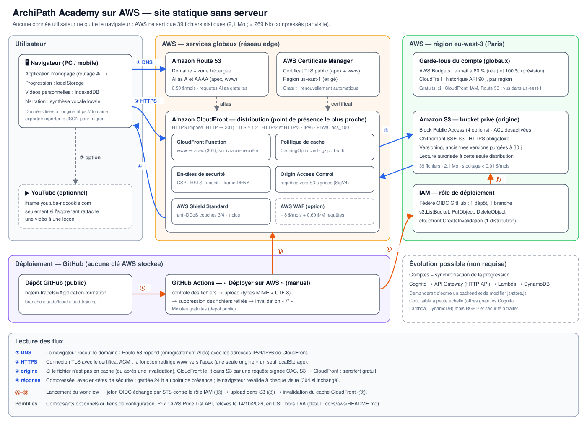

# Mettre ArchiPath Academy en ligne sur AWS

> **En une phrase** : l'application est un site **100 % statique**. L'architecture la plus juste est donc un bucket **S3 privé** (Paris), servi en HTTPS par **CloudFront**, avec un nom de domaine **Route 53** et un certificat **ACM** gratuit. Les mises à jour passent par **GitHub Actions**, sans aucune clé AWS stockée.
> **Coût pour un usage personnel ou un petit groupe : ≈ 0,50 $ par mois hors TVA**, plus le nom de domaine (payé une fois par an).

Tout ce qui suit a été **vérifié**, et la méthode est indiquée pour chaque point. Ce que je n'ai **pas** pu vérifier est listé à part, au [§ 10](#10-ce-que-je-nai-pas-pu-vérifier).

---

## 1. Ce que l'application exige vraiment (constats mesurés sur le dépôt)

| Constat | Méthode | Conséquence pour l'architecture |
|---|---|---|
| Aucune requête réseau (`fetch`, XHR, WebSocket) dans le code | recherche dans `js/*.js` | **Pas de backend, pas de base de données** : un hébergement statique suffit |
| Routage par fragment `#/…` | `location.hash` dans `js/app.js` | Pas besoin de réécrire les 404 vers `index.html` : le fragment n'est jamais envoyé au serveur |
| 39 fichiers chargés par visite : `index.html`, 1 CSS, 5 JS moteur, 32 JS de données | analyse de `index.html` + simulation `aws s3 cp --dryrun` | Le coût est dominé par le **nombre de requêtes**, pas par le volume (voir § 5) |
| 753 Kio bruts, **≈ 269 Kio compressés** par visite ; 2,1 Mo publiés au total | mesure gzip niveau 9 | Transfert négligeable (1 To/mois gratuit sur CloudFront) |
| Progression dans `localStorage`, vidéos perso dans IndexedDB | `js/store.js` | Les données sont **liées à l'origine** (`https://domaine`) : il faut **une seule** adresse (www redirigé) et une migration par export/import JSON |
| Seule ressource tierce : iframe `youtube-nocookie.com`, et seulement si l'apprenant ajoute une vidéo | analyse de `js/app.js` | Politique CSP stricte possible, **testée sans aucune violation** (§ 7) |
| Attributs `style="…"` dans l'interface, aucun script inline | analyse du code | CSP : `script-src 'self'` strict, `style-src` avec `'unsafe-inline'` |
| Dépôt **public** `hatem-trabelsii/Application-formation`, branche par défaut `claude/local-cloud-training-platform-e7bo51`, **aucune branche `main`** | API GitHub | Le rôle de déploiement est restreint à cette branche (paramètre modifiable) |

---

## 2. Schéma d'architecture



**Trafic utilisateur (bleu)**

1. **DNS** : le navigateur résout `archipath.fr` (exemple de domaine). Route 53 répond avec des enregistrements **Alias A et AAAA** qui pointent vers CloudFront. Les requêtes vers un Alias sont gratuites.
2. **HTTPS** : connexion TLS (version 1.2 minimum) avec le certificat ACM, en HTTP/2 ou HTTP/3 et en IPv6. Le HTTP est redirigé en 301 vers le HTTPS. Une CloudFront Function redirige `www` vers le domaine principal (apex).
3. **Origine** : si le fichier n'est pas en cache, CloudFront le lit dans S3 par une requête **signée** (Origin Access Control, SigV4). Le bucket refuse tout autre accès. Le transfert de S3 vers CloudFront est gratuit.
4. **Réponse** : compressée (gzip ou brotli), avec les en-têtes de sécurité (CSP, HSTS…). Elle est gardée 24 h au point de présence, et le navigateur la revalide à chaque visite (réponse 304 si rien n'a changé).
5. **Option** : l'iframe YouTube, seulement si l'apprenant rattache une vidéo à une leçon.

**Déploiement (orange)**

- Ⓐ Lancement manuel du workflow.
- Ⓑ Le jeton OIDC de GitHub est échangé par STS contre le rôle IAM (aucune clé stockée).
- Ⓒ Upload des fichiers dans S3, avec types MIME et UTF-8 explicites, puis suppression des fichiers retirés du dépôt.
- Ⓓ Invalidation `/*` du cache CloudFront.

---

## 3. Services retenus, et pourquoi

| Service | Rôle | Réglages importants | Pourquoi ce choix |
|---|---|---|---|
| **Amazon S3** (eu-west-3, Paris) | Stocke les 39 fichiers | Accès public bloqué (4 options), ACL désactivées, SSE-S3, versioning avec purge à 30 j, HTTPS imposé, lecture réservée à **cette** distribution | Stockage durable et quasi gratuit pour 2 Mo ; données en France |
| **Amazon CloudFront** | HTTPS, cache, compression, en-têtes | OAC, `redirect-to-https`, TLSv1.2_2021, HTTP/2+3, IPv6, CachingOptimized, PriceClass_100 | Le point de terminaison « website » de S3 **ne gère pas le HTTPS** ; CloudFront apporte aussi 1 To et 10 M requêtes gratuits par mois |
| **CloudFront Function** | Redirection `www` → apex | Runtime `cloudfront-js-2.0`, 464 octets | Une seule origine = un seul `localStorage` ; 2 M exécutions gratuites par mois |
| **Response headers policy** | Sécurité navigateur | CSP, HSTS 2 ans, nosniff, `frame DENY`, Referrer-Policy, Permissions-Policy | Testée sur les 110 écrans de l'application, sans violation |
| **ACM** (us-east-1) | Certificat TLS | Validation DNS automatique, apex + www | **Gratuit**, renouvelé automatiquement ; CloudFront **exige** us-east-1 |
| **Route 53** | Domaine + DNS | Alias A/AAAA pour l'apex et www | Les Alias vers CloudFront sont autorisés à l'apex (pas un CNAME) et gratuits |
| **IAM + OIDC GitHub** | Déploiement sans clé | Rôle limité à 1 dépôt, 1 branche, 4 actions | Aucune clé d'accès à faire fuiter ou à renouveler |
| **AWS Budgets** | Alerte de coût | E-mail à 80 % du réel et 100 % de la prévision (5 $ par défaut) | Gratuit (les budgets sans action ne coûtent rien) |
| **Shield Standard** | Anti-DDoS couches 3/4 | Automatique | Inclus avec CloudFront |
| **CloudTrail** (historique) | Qui a fait quoi | Activé par défaut, 90 jours, **par région** | Gratuit ; actions CloudFront, IAM et Route 53 visibles dans **us-east-1** |

**Alternatives écartées, et pourquoi :**
- **S3 « static website hosting » seul** : pas de HTTPS sur un domaine personnalisé, et le bucket doit être public.
- **EC2 / Lightsail** : un serveur à maintenir, patcher et payer en continu, pour servir 2 Mo de fichiers statiques.
- **AWS Amplify Hosting** : très simple (connexion GitHub, builds automatiques), mais le Go servi coûte **0,15 $ contre 0,085 $** sur CloudFront à l'usage (prix Paris) et donne moins de contrôle. C'est une bonne alternative si tu veux zéro configuration.
- **WAF** : non activé par défaut. Pour un site statique sans formulaire ni API, le bénéfice est faible pour ≈ 8 $/mois. À ajouter en cas d'abus constaté (§ 9).

---

## 4. Le code d'infrastructure fourni (validé)

| Fichier | Contenu | Validation effectuée |
|---|---|---|
| [`cloudformation/01-certificat-us-east-1.yaml`](cloudformation/01-certificat-us-east-1.yaml) | Certificat ACM apex + www, validation DNS automatique ; une règle empêche le déploiement hors us-east-1 | `cfn-lint 1.57.2` : 0 erreur, 0 avertissement |
| [`cloudformation/02-site-eu-west-3.yaml`](cloudformation/02-site-eu-west-3.yaml) | S3, OAC, politique de bucket, fonction, en-têtes, distribution, DNS, OIDC, rôle, budget | `cfn-lint 1.57.2` : 0 erreur, 0 avertissement ; fonction testée (www → 301, apex → transmis) ; CSP testée sur 110 écrans |
| [`../../.github/workflows/deploy-aws.yml`](../../.github/workflows/deploy-aws.yml) | Workflow manuel de publication | Schéma officiel des workflows GitHub (`check-jsonschema`) : OK ; syntaxe bash des étapes : OK ; filtres `aws s3` simulés (`--dryrun`) : 39 fichiers exactement |
| [`estimation_couts.py`](estimation_couts.py) | Calcul des coûts du § 5 | Résultats recalculés à la main |

**Pourquoi deux piles et pas une seule ?** Une pile CloudFormation crée ses ressources dans **sa** région. Or le certificat utilisé par CloudFront doit être en **us-east-1**, et le bucket est voulu à **Paris**.

---

## 5. Coûts

### 5.1 Prix unitaires officiels

Source : AWS Price List API, relevés le **14/10/2026**. Montants en USD, hors TVA.

| Poste | Prix | Offre gratuite permanente |
|---|---|---|
| CloudFront – transfert sortant (Europe, 10 premiers To) | 0,085 $/Go | **1 To/mois** |
| CloudFront – requêtes HTTPS (Europe) | 0,0120 $ / 10 000 | **10 M/mois** |
| CloudFront Functions | 0,10 $ / million | **2 M/mois** |
| CloudFront – invalidations | 0,005 $ par chemin | **1 000 chemins/mois** (`/*` compte pour 1) |
| S3 Standard – stockage (Paris) | 0,024 $/Go-mois | — |
| S3 – PUT/COPY/POST/LIST (Paris) | 0,0053 $ / 1 000 | — |
| S3 – GET (Paris) | 0,0042 $ / 10 000 | — |
| S3 → CloudFront | 0 $ | — |
| Route 53 – zone hébergée | 0,50 $/mois (25 premières) | — |
| Route 53 – requêtes vers un Alias | 0 $ | — |
| ACM – certificat public | 0 $ | — |
| AWS Budgets (sans action) | 0 $ | — |
| WAF (option) | 5 $/ACL/mois + 1 $/règle/mois + 0,60 $/million de requêtes | — |

### 5.2 Coût mensuel par scénario

Une session = un chargement de l'application (39 requêtes, ≈ 269 Kio). Ensuite, la navigation interne ne déclenche aucune requête.

| Scénario | Sessions/mois | Données | Requêtes | **Sans WAF** | Avec WAF (3 règles) | Fichiers regroupés (3/visite), sans WAF |
|---|---:|---:|---:|---:|---:|---:|
| Usage personnel (1 apprenant, 60 sessions) | 60 | 0,0 Go | 2 340 | **0,50 $** | 8,51 $ | 0,50 $ |
| Petit groupe (500 apprenants × 20 sessions) | 10 000 | 2,6 Go | 390 000 | **0,51 $** | 8,75 $ | 0,51 $ |
| Communauté (20 000 × 20 sessions) | 400 000 | 102,6 Go | 15 600 000 | **8,59 $** | 25,95 $ | 0,51 $ |
| Très forte audience (2 millions de sessions) | 2 000 000 | 513,1 Go | 78 000 000 | **89,71 $** | 144,51 $ | 0,91 $ |

Exemple de vérification manuelle (scénario « Communauté ») :
- requêtes : 15,6 M − 10 M gratuites = 5,6 M × 0,0000012 $ = **6,72 $** ;
- fonction : 15,6 M − 2 M gratuites = 13,6 M × 0,0000001 $ = **1,36 $** ;
- zone DNS : **0,50 $**.

Le transfert (102,6 Go) reste dans le To gratuit.

**Enseignement clé** : au-delà de quelques centaines de milliers de sessions, ce sont les **39 fichiers par visite** qui coûtent. Les regrouper en 3 fichiers (une petite étape de build) ferait passer la facture de 89,71 $ à 0,91 $ à 2 millions de sessions : 13 fois moins de requêtes, qui retombent presque entièrement dans l'offre gratuite. Inutile tant que l'usage reste personnel.

### 5.3 Coûts ponctuels et annuels

| Poste | Montant | Remarque |
|---|---|---|
| Nom de domaine | **≈ 10 à 20 $ par an pour un `.com`** (prix exact affiché par Route 53 avant achat) | ⚠️ Non vérifiable depuis mon environnement ; selon un article tiers, AWS a révisé les tarifs d'environ 270 extensions le 1er juillet 2026. `.fr` : réservé aux personnes résidant, ou aux entreprises établies, dans l'Union européenne, en Islande, au Liechtenstein, en Norvège ou en Suisse (règles AFNIC) |
| Création de l'infrastructure | 0 $ | Aucun frais de mise en service |
| Temps de mise en place | ≈ 1 h à 1 h 30 | Dont ≈ 30 min d'attentes (validation du certificat, distribution, DNS) |

### 5.4 Ce qui change la facture finale

- **TVA** : AWS facture les particuliers en France avec **20 % de TVA**. Exemple : 0,50 $ → 0,60 $ TTC.
- **Devise** : facturation en USD. Le paiement en euros applique le taux de change d'AWS ou de ta banque.
- **Comptes créés depuis le 15/07/2025** : 100 $ de crédits à l'inscription, et jusqu'à 100 $ de plus via des activités. Le **plan gratuit** dure 6 mois au maximum (ou jusqu'à épuisement des crédits) et bloque certains services. Les crédits promotionnels ne couvrent généralement **pas** l'achat de noms de domaine (à confirmer dans la console Billing).
- **Forfaits CloudFront « flat-rate »** (annoncés fin 2025) : un plan **Free à 0 $/mois** (≈ 1 M de requêtes et 100 Go inclus, sans facturation de dépassement, WAF et DNS inclus selon AWS). Avec 39 requêtes par visite, 1 M de requêtes ≈ **25 600 sessions par mois**. ⚠️ Ces forfaits n'apparaissent pas dans l'API de prix, et une page AWS indique qu'ils ne sont pas accessibles aux comptes en plan gratuit : à vérifier dans la console avant de compter dessus. La tarification à l'usage décrite ici reste la référence.

**Total réaliste pour toi la première année** : environ **6 $ d'hébergement** (12 × 0,50 $) + le domaine, soit **≈ 20 à 30 $ TTC**, probablement couverts en partie par les crédits d'un compte neuf.

---

## 6. Étapes de mise en place

> Remplace `archipath.fr` par ton domaine dans toutes les commandes. Les commandes utilisent l'**AWS CLI v2**.

### Étape 0 — Préparer le compte (20 min)

1. Crée le compte AWS et active la **MFA sur l'utilisateur racine**. Ne t'en sers plus ensuite.
2. Active **IAM Identity Center**, crée ton utilisateur avec `AdministratorAccess` et connecte la CLI :
   ```bash
   aws configure sso            # profil par défaut, région eu-west-3
   aws sts get-caller-identity  # doit afficher ton compte, sans la racine
   ```
3. Crée **tout de suite** un budget de 5 $ (Billing › Budgets). Le template en crée aussi un, mais seulement plus tard.

### Étape 1 — Nom de domaine et zone DNS (10 min + attente)

- **Achat via Route 53** (le plus simple) : Route 53 › Domaines enregistrés › Enregistrer un domaine. Le prix exact est affiché avant paiement. La **zone hébergée est créée automatiquement**.
  - Garde la protection de la vie privée et le renouvellement automatique activés.
  - **Confirme l'e-mail de vérification du titulaire sous 15 jours**, sinon le domaine est suspendu. C'est une règle de l'ICANN pour les extensions génériques comme `.com` ; les extensions nationales comme `.fr` ont leurs propres règles.
- **Domaine déjà acheté ailleurs** : crée une zone hébergée publique dans Route 53, puis remplace les serveurs DNS chez ton registraire par les 4 serveurs `NS` de la zone.
- Récupère l'identifiant de zone :
  ```bash
  aws route53 list-hosted-zones-by-name --dns-name archipath.fr \
    --query "HostedZones[0].Id" --output text      # → /hostedzone/Z0123…  (garder Z0123…)
  ```

### Étape 2 — Certificat TLS en us-east-1 (5 à 30 min)

```bash
aws cloudformation deploy --region us-east-1 \
  --stack-name archipath-certificat \
  --template-file docs/aws/cloudformation/01-certificat-us-east-1.yaml \
  --parameter-overrides DomainName=archipath.fr HostedZoneId=Z0123456789ABCDEFGHIJ

aws cloudformation describe-stacks --region us-east-1 --stack-name archipath-certificat \
  --query "Stacks[0].Outputs[?OutputKey=='CertificateArn'].OutputValue" --output text
```

La commande rend la main quand le certificat est **émis** : CloudFormation crée lui-même les enregistrements de validation DNS.

### Étape 3 — Site, CDN, DNS, rôle de déploiement, budget (10 à 20 min)

Vérifie d'abord si le fournisseur OIDC de GitHub existe déjà (un seul par compte) :

```bash
aws iam list-open-id-connect-providers   # s'il contient token.actions.githubusercontent.com → CreateGitHubOidcProvider=false
```

```bash
aws cloudformation deploy --region eu-west-3 \
  --stack-name archipath-site \
  --template-file docs/aws/cloudformation/02-site-eu-west-3.yaml \
  --capabilities CAPABILITY_IAM \
  --parameter-overrides \
      DomainName=archipath.fr \
      HostedZoneId=Z0123456789ABCDEFGHIJ \
      CertificateArn=arn:aws:acm:us-east-1:123456789012:certificate/… \
      BudgetEmail=ton.adresse@exemple.fr \
      CreateGitHubOidcProvider=true

aws cloudformation describe-stacks --region eu-west-3 --stack-name archipath-site \
  --query "Stacks[0].Outputs" --output table
```

`CAPABILITY_IAM` est obligatoire, car la pile crée un rôle IAM. Note les sorties `BucketName`, `DistributionId` et `DeployRoleArn`.

### Étape 4 — Relier GitHub (5 min)

Dans le dépôt GitHub : **Settings › Secrets and variables › Actions › onglet Variables › New repository variable** :

| Nom | Valeur (sortie de la pile) |
|---|---|
| `AWS_DEPLOY_ROLE_ARN` | `DeployRoleArn` |
| `AWS_BUCKET` | `BucketName` |
| `AWS_DISTRIBUTION_ID` | `DistributionId` |

Ce sont des **variables**, pas des secrets : aucune n'est sensible, car l'accès est protégé par la confiance OIDC limitée à ton dépôt et à ta branche.

### Étape 5 — Premier déploiement (2 à 5 min)

Onglet **Actions › Déployer sur AWS › Run workflow**, sur la branche `claude/local-cloud-training-platform-e7bo51`.

Le workflow vérifie la configuration et les 39 fichiers, publie, invalide le cache, puis attend la fin de l'invalidation.

> Un workflow `workflow_dispatch` n'apparaît dans l'onglet Actions que s'il existe sur la **branche par défaut** du dépôt. C'est le cas ici.

### Étape 6 — Vérifier (§ 7), puis migrer ta progression

Ta progression locale est rattachée à `file://` (double-clic) ou à `http://localhost:8000`. Le navigateur ne la partagera **pas** avec `https://archipath.fr`. Pour la migrer :
1. dans l'ancienne version, ⚙️ Paramètres › **Exporter ma progression** ;
2. sur le site en ligne, ⚙️ Paramètres › **Importer**.

### Étape 7 — Mentions légales (recommandé)

Un site public édité en France doit indiquer l'identité de l'éditeur, ou, pour un particulier non professionnel, au minimum les coordonnées de l'hébergeur (loi LCEN) :

> Hébergeur : Amazon Web Services EMEA SARL, 38 avenue John F. Kennedy, L-1855 Luxembourg.

Côté RGPD : le site ne dépose **aucun cookie** et ne collecte rien. Les journaux d'accès CloudFront ne sont **pas** activés, donc aucune adresse IP n'est stockée par toi. *Je ne suis pas juriste : vérifie selon ta situation.*

---

## 7. Vérifications après mise en ligne

```bash
dig +short archipath.fr A ; dig +short archipath.fr AAAA        # adresses CloudFront (IPv4 et IPv6)
curl -sI http://archipath.fr/        | grep -iE '^HTTP|^location'  # 301 → https://archipath.fr/
curl -sI https://www.archipath.fr/   | grep -iE '^HTTP|^location'  # 301 → https://archipath.fr/
curl -sI https://archipath.fr/       | grep -iE '^HTTP|content-type|strict-transport|content-security|x-cache'
#   attendu : HTTP/2 200 · text/html; charset=utf-8 · HSTS · CSP · « Hit/Miss from cloudfront »
curl -sI -H 'Accept-Encoding: br' https://archipath.fr/js/app.js | grep -i content-encoding   # br
curl -sI "https://<BucketName>.s3.eu-west-3.amazonaws.com/index.html" | head -1             # 403 : bucket bien privé
```

Ensuite, dans le navigateur :
- console sans erreur CSP ;
- une leçon vidéo se lit avec la voix ;
- un quiz, une animation et l'export de progression fonctionnent.

Ce qui a **déjà** été vérifié dans mon environnement, avec exactement les en-têtes du template :
- **110 écrans parcourus, 0 violation CSP, 0 erreur JavaScript** ;
- iframe YouTube et vidéo locale (`blob:`) autorisées.

---

## 8. Exploiter au quotidien

- **Mettre à jour** : pousse sur la branche, puis lance le workflow. Pour un déploiement automatique, ajoute `push: { branches: [claude/local-cloud-training-platform-e7bo51] }` sous `on:` dans le workflow.
- **Revenir en arrière** : `git revert` du commit fautif, puis relance du workflow. Le versioning S3 garde aussi chaque ancienne version de fichier pendant 30 jours.
- **Surveiller** :
  - e-mails AWS Budgets ;
  - Cost Explorer (Billing) ;
  - métriques CloudFront (onglet Monitoring) : requêtes, taux d'erreurs 4xx/5xx, taux de cache.
- **Si tu changes de branche** (par exemple pour créer `main`) : redéploie la pile 02 avec `GitHubBranch=main`, sinon GitHub ne pourra plus assumer le rôle.
- **Tout supprimer** :
  1. supprime la pile `archipath-site`. Le bucket est **conservé** (`DeletionPolicy: Retain`) : vide-le, **y compris ses anciennes versions**, puis supprime-le ;
  2. supprime la pile `archipath-certificat` ;
  3. supprime la zone hébergée (sinon 0,50 $/mois continuent) ;
  4. désactive le renouvellement automatique du domaine.

---

## 9. Points d'attention

1. **Une seule adresse** : `www` est redirigé vers l'apex, car `localStorage` est propre à chaque origine. Changer de domaine plus tard « perdrait » la progression des apprenants, sauf export/import.
2. **Cache et fichiers sans empreinte** : les fichiers gardent le même nom d'une version à l'autre. D'où `max-age=0` pour le navigateur (revalidation, réponse 304), `s-maxage=86400` pour CloudFront, et une invalidation `/*` à chaque déploiement. Pendant les quelques secondes de l'upload, les fichiers déjà en cache restent dans l'ancienne version. Mais un fichier **absent** du cache d'un point de présence serait lu dans sa nouvelle version : un mélange bref est possible pour un visiteur qui charge le site exactement à ce moment. Il disparaît à l'invalidation, et un simple rechargement suffit.
3. **Encodage** : les données contiennent des accents et des emojis. Le workflow force `charset=utf-8` sur le HTML, le CSS et le JS.
4. **La CloudFront Function s'exécute à chaque requête**, pas seulement pour `www`. Elle est gratuite jusqu'à 2 M d'exécutions, et c'est le 2e poste de coût à forte audience. Sans `www`, on peut la retirer.
5. **Accès refusé = 403, pas 404** : la politique du bucket n'accorde pas `s3:ListBucket` à CloudFront (moindre privilège). Une URL inexistante renvoie donc 403. C'est sans effet sur l'application, puisque tout passe par `#/`.
6. **Voix** : certaines voix « en ligne » de Chrome (par exemple « Google français ») envoient le texte lu aux serveurs de Google. C'est sans données personnelles ici, mais à savoir. Les voix du système restent locales.
7. **Sécurité du compte** : MFA partout, aucune clé d'accès longue durée. Le rôle de déploiement ne peut écrire que dans **ce** bucket et invalider **cette** distribution.
8. **En cas d'abus** (robots, pics anormaux) : ajoute un WAF avec une règle de limitation de débit (≈ 8 $/mois), ou passe sur un forfait flat-rate qui l'inclut.
9. **Contenu public** : tout ce qui est dans le dépôt devient visible en ligne. C'est déjà le cas, puisque le dépôt GitHub est public. Des captures d'écran de tests avaient été commitées par erreur : elles ont été **retirées**, et `*.png` est maintenant ignoré par Git.

---

## 10. Ce que je n'ai pas pu vérifier

| Point | Pourquoi | Comment le vérifier |
|---|---|---|
| Prix exact du nom de domaine (`.com`, `.fr`) | Pages de tarifs Route 53 inaccessibles depuis mon environnement | Console Route 53 : le prix s'affiche avant l'achat |
| Détail et éligibilité des forfaits CloudFront flat-rate | Absents de l'API de prix ; sources AWS partiellement contradictoires sur l'éligibilité | Console CloudFront › Plans de tarification |
| Déploiement réel des piles | Pas de compte AWS dans mon environnement : validation statique (`cfn-lint`) et tests locaux uniquement | Étapes 2 et 3 ; en cas d'échec, l'onglet « Événements » de la pile donne la cause exacte |
| Durées d'attente (certificat, distribution) | Dépendent d'AWS et de la propagation DNS | Indicatives : de quelques minutes à 30 min |

---

## 11. Sources

- AWS Price List API : `https://pricing.us-east-1.amazonaws.com/offers/v1.0/aws/index.json`, publication du 14/10/2026. Fichiers utilisés : AmazonCloudFront (aws-other), AmazonS3 (eu-west-3), AmazonRoute53 (aws-other), awswaf (us-east-1), AWSCertificateManager (us-east-1), AWSBudgets, AWSAmplify (eu-west-3).
- [Tarifs Amazon CloudFront](https://aws.amazon.com/cloudfront/pricing/), [FAQ CloudFront](https://aws.amazon.com/cloudfront/faqs/), [forfaits flat-rate (guide développeur)](https://docs.aws.amazon.com/AmazonCloudFront/latest/DeveloperGuide/flat-rate-pricing-plan.html), [annonce des forfaits flat-rate](https://aws.amazon.com/blogs/networking-and-content-delivery/introducing-flat-rate-pricing-plans-with-no-overages).
- [Offre gratuite AWS (comptes créés depuis le 15/07/2025)](https://aws.amazon.com/about-aws/whats-new/2025/07/aws-free-tier-credits-month-free-plan/), [documentation Free Tier](https://docs.aws.amazon.com/en_us/awsaccountbilling/latest/aboutv2/free-tier.html).
- Outils de validation : `cfn-lint` 1.57.2, `check-jsonschema` (schéma des workflows GitHub), AWS CLI 1.46 (`--dryrun`), Playwright/Chromium (tests CSP).
